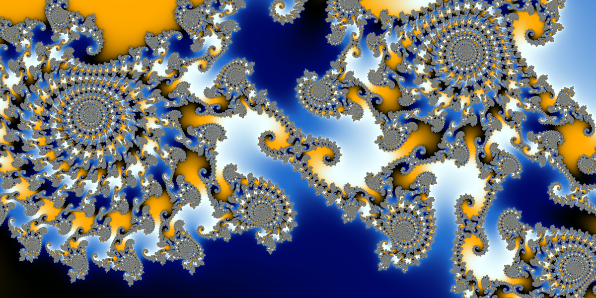
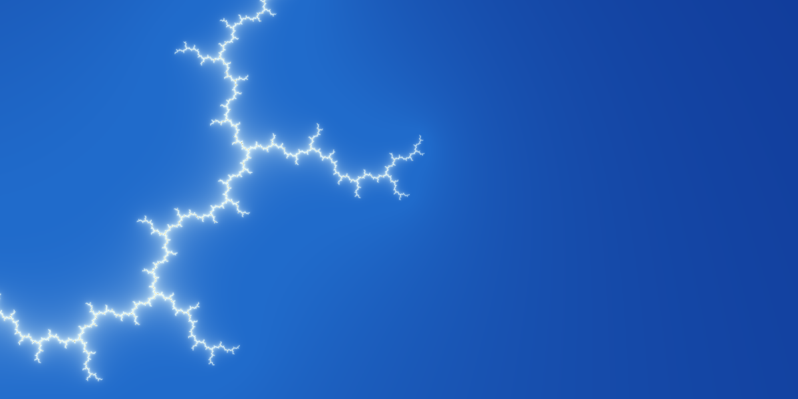

# Fractaland

Real-time Mandelbrot viewer with palette rotation and continuous zoom, computed on the GPU with Numba-CUDA (CPU fallback via Numba). Perturbation rendering keeps images exact down to 10²⁹⁰ zoom.



## Requirements

- Windows or Linux, Python 3.12.
- For the GPU path: an NVIDIA GPU with a current driver. The CUDA compiler parts come as pip packages (`numba-cuda[cu12]`), so no CUDA Toolkit install is needed. Without a GPU the app runs on the CPU.
- numpy is pinned below 2.5, because numba-cuda 0.30 still uses a function that numpy 2.5 removed.

## Run

```
python -m venv .venv
.venv\Scripts\activate
pip install -r requirements.txt
python main.py                 # --fullscreen, --cpu, --size 1600x900
```

The first start compiles the kernels (some seconds); later starts use Numba's on-disk cache.

## Controls

All commands are in the menu bar (File, View, Zoom, Render, Palette, Help), which shows their shortcuts. In fullscreen the menu bar is hidden; Alt shows it.

| Input | Action |
|---|---|
| Wheel | zoom at cursor |
| Hold left / right button | continuous zoom in / out toward the cursor |
| Middle drag, or Shift + left drag | pan |
| PgUp / PgDn | zoom in / out at the centre |
| `,` / `.` | zoom speed down / up |
| `[` / `]` (Ctrl: larger step) | rotate palette |
| Space | automatic palette rotation on/off |
| `{` / `}` | rotation speed down / up |
| `+` / `-` | max iterations up / down |
| I | iteration depth dialog (base limit, growth with zoom) |
| L | linear / log colour mapping |
| P | precision auto / f32 / f64 / perturbation |
| A | 2×2 antialiasing of the still frame on/off |
| T | temporal smoothing while moving on/off |
| G | palette filtering on/off |
| F11 or F / Esc | toggle / leave fullscreen |
| S | screenshot to `screenshots/` (PNG + JSON state), at the selected render resolution |
| R | reset view; H HUD; F1 help; Ctrl+Q quit |

View → Render Resolution sets how many pixels are computed, independent of the window: a fraction of the window's pixels (100/75/50/25 %) or a fixed number of lines (720–2160, width follows the window's aspect ratio).

## Deep zoom

Render → Precision → Auto uses float32 while it is accurate (to about 10³ zoom), then **perturbation**:
- One reference point (the view center) is iterated on the CPU in arbitrary precision (gmpy2).
- Every pixel is then iterated on the GPU only as a small float64 difference from that reference orbit.
- When the pixel's orbit comes closer to 0 than that difference, the pixel restarts from the start of the reference orbit ("rebasing"), which keeps the result exact.

This keeps images correct down to 10²⁹⁰ zoom, the limit of float64 offsets. Direct float64 is still selectable, but it already misjudges boundary pixels from about 10⁶. The HUD shows the reference orbit's length, its bits of precision and how long it took to compute; it is computed once and reused while you zoom toward a point.



## Smooth zooming

Fine detail used to sparkle while zooming. One sample per pixel catches an essentially random colour where the palette changes faster than once per pixel, and each frame shifts the pixel grid. Two measures remove this:

- **Palette filtering:** each pixel takes the average palette colour over the range its neighbours span, instead of one point of the palette.
- **Temporal smoothing:** while moving, every frame samples a different point inside each pixel. The previous frames, warped exactly to the new view, are blended in, so a few frames together act like supersampling.

The resolution used while moving changes in fixed steps rather than every frame. The reference orbit for deep zoom is computed in a separate process, so the view never freezes. `python tools/flicker.py` measures the effect: frame-to-frame flicker in the seahorse valley drops from 11–20 % of pixels to under 0.1 %.

## Tools

- `python tools/render_png.py out.png --size 3840x2160 --state screenshots/<name>.json` renders a saved view offline.
- `python tools/flicker.py` measures zoom flicker and sharpness for each anti-flicker setting.
- `python tools/benchmark.py --cpu` times 1080p frames per backend and precision.
- `pytest tests` checks GPU against CPU results, palettes and view maths.

## Structure

- `fractaland/state.py`: `View`, `RenderParams`, `ColorParams`, `FrameState` (JSON-serialisable; a frame is fully defined by these plus a size).
- `fractaland/fractals/mandelbrot.py`: per-pixel iteration, compiled for both GPU and CPU.
- `fractaland/color/palettes.py`: colour stops → cyclic LUT, shading function.
- `fractaland/engine/`: `Engine` (`compute` → smooth counts kept on the GPU; `colorize` → RGBA), CUDA and CPU backends.
- `fractaland/ui/`: Qt window and canvas (render loop, adaptive resolution while moving, HUD).

## License

MIT, see [LICENSE](LICENSE).
